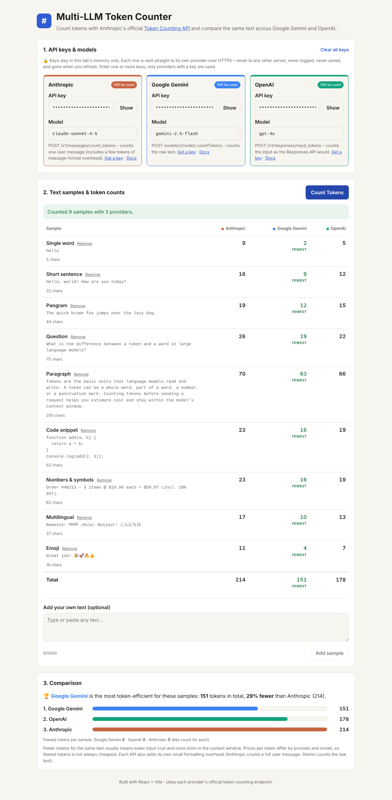

# Multi-LLM Token Counter (Anthropic + Gemini + OpenAI)

A React + Vite web app that counts tokens for a set of predefined text samples using
Anthropic's official **Token Counting API**
(`POST https://api.anthropic.com/v1/messages/count_tokens`), and compares the same text
with **Google Gemini** and **OpenAI** to show which model uses the **fewest tokens**.

**Live demo:** https://sandeep-multi-llm-token-counter.vercel.app/



## Features

- **API keys for 3 providers** – Anthropic (required by the assignment), Google Gemini and
  OpenAI (optional). Use one, two or all three; only providers with a key are called.
  Password fields with Show/Hide and a "Clear all keys" button.
- **Model per provider** – editable model name with suggestions
  (e.g. `claude-sonnet-4-5`, `gemini-2.5-flash`, `gpt-4o`).
- **Predefined samples** – single word, sentences, paragraph, code, numbers, multilingual text, emoji.
- **Add your own text** – optional custom samples (can also be removed).
- **Count Tokens button** – counts every sample with every selected provider
  (4 requests at a time) and shows the results in a side-by-side table.
- **Comparison** – the lowest count in each row is highlighted as **FEWEST**, totals are
  shown per provider, and a summary names the most token-efficient provider, how much
  fewer tokens it used (in %), and a bar chart ranking all providers.
- **Loading states** – spinner on the button and in every cell; Cancel button while counting.
- **Error handling** – clear messages for:
  - no key entered / badly formatted key (checked locally, no request sent)
  - invalid key (401, or Gemini's 400 "API key not valid") – stops that provider's remaining
    requests immediately while other providers continue
  - no permission (403), unknown model (404), rate limit / quota (429), server errors (5xx)
  - network failures and 20-second timeouts
  - per-cell error message for anything that failed
- **Responsive & accessible** – the table turns into stacked cards on phones, dark mode,
  keyboard focus styles, ARIA live regions.

## Official APIs used

| Provider | Endpoint | Returns |
|---|---|---|
| Anthropic | `POST https://api.anthropic.com/v1/messages/count_tokens` | `input_tokens` |
| Google Gemini | `POST https://generativelanguage.googleapis.com/v1beta/models/{model}:countTokens` | `totalTokens` |
| OpenAI | `POST https://api.openai.com/v1/responses/input_tokens` (via `/api/openai-count`, see below) | `input_tokens` |

Token counting is free on all three, but each has its own rate limits. Counts are not perfectly
"apples to apples": Anthropic counts a full user message (adds a few formatting tokens), Gemini
counts the raw text, and OpenAI counts the input as the Responses API would. Fewer tokens also
doesn't automatically mean cheaper, because price per token differs between providers and models.

## API key security

- Keys are **never hardcoded** – there are no keys in the source code or in any `.env` file.
- They are kept **only in React state (memory)**. They are not written to `localStorage`,
  `sessionStorage`, cookies or the URL, and refreshing the page clears them.
- They are **never logged** (no `console.log` of keys or request headers).
- Each key is sent **only to its own provider** over HTTPS, always in a request **header**
  (`x-api-key`, `x-goog-api-key`, `Authorization: Bearer`) – never in the URL – with
  `credentials: 'omit'` and `cache: 'no-store'`.
- **OpenAI exception:** OpenAI blocks direct browser (CORS) requests that carry an API key, so
  the OpenAI request goes through this app's own tiny Vercel serverless function
  [`api/openai-count.js`](api/openai-count.js). It forwards the request to
  `api.openai.com/v1/responses/input_tokens` and returns the result. It does not store, cache or
  log the key, only accepts `POST`, validates the input, and marks responses `no-store`.
  During local development, Vite's dev-server proxy does the same job (see `vite.config.js`).
- Inputs disable autocomplete / password-manager capture.

**Why the browser calls the APIs directly:** the app has no backend, so for Anthropic it sends
the `anthropic-dangerous-direct-browser-access: true` header that Anthropic requires for browser
(CORS) requests. That header exists to warn developers not to ship **their own** secret key in
front-end code. This app doesn't: each user types **their own** keys at runtime and they never
leave the browser except to go to the matching provider. In a production app where the site owner
pays for the keys, you would put a small server (proxy) in between instead.

## Tech stack

- React 19 (functional components and hooks)
- Vite (dev server and build)
- Plain CSS (no UI library)
- `fetch` for HTTP (no SDK needed)

## Project structure

```
api/
└── openai-count.js           # Vercel serverless function that forwards OpenAI requests
src/
├── api/providers.js          # Anthropic / Gemini / OpenAI calls, timeout, error mapping, key checks
├── components/ProviderCard.jsx   # key + model inputs for one provider
├── components/ResultsTable.jsx   # side-by-side counts, FEWEST highlight, totals
├── components/Summary.jsx        # winner, % saved, bar chart
├── utils/compare.js          # "fewest tokens" helper
├── data/samples.js           # predefined text samples
├── App.jsx                   # state, Count Tokens flow, layout
├── main.jsx
└── styles.css
```

## Setup and run locally

**Requirements:** [Node.js](https://nodejs.org) 20 or newer, and at least one API key:

- Anthropic: <https://console.anthropic.com/settings/keys>
- Google Gemini (optional): <https://aistudio.google.com/apikey>
- OpenAI (optional): <https://platform.openai.com/api-keys>

```bash
git clone <your-repo-url>
cd anthropic-token-counter
npm install
npm run dev
```

Open the URL shown in the terminal (usually <http://localhost:5173>), paste one or more API keys,
and click **Count Tokens**.

Other commands:

```bash
npm run build     # production build into dist/
npm run preview   # serve the production build locally
npm run lint      # lint the source
```

## Deploy (Vercel)

1. Push this project to a GitHub repository.
2. On <https://vercel.com>, choose **Add New → Project**, import the repository.
3. Vercel detects Vite automatically (build command `npm run build`, output `dist`). Click **Deploy**.
4. No environment variables are needed – users enter their own keys in the app.

## References

- Token counting guide: <https://docs.anthropic.com/en/docs/build-with-claude/token-counting>
- API reference: <https://docs.anthropic.com/en/api/messages-count-tokens>
- Gemini token counting: <https://ai.google.dev/api/tokens>
- OpenAI token counting: <https://developers.openai.com/api/docs/guides/token-counting>
